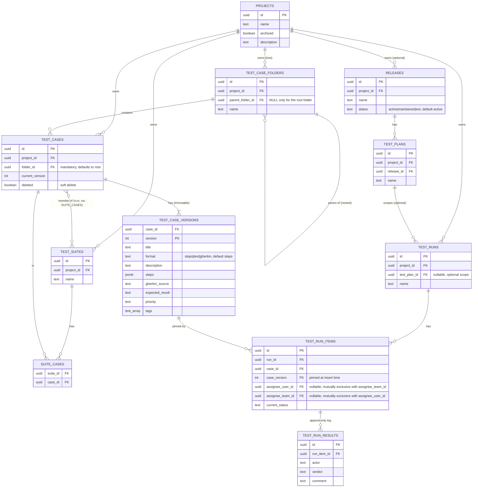

# Database

PostgreSQL 16+. The schema is built from incremental migration files,
[`apps/api/internal/db/migrations/`](../apps/api/internal/db/migrations/),
embedded in the binary and applied at startup via goose — one file per
change, never edited once merged (see CLAUDE.md's migration policy).
**The migrations directory is the source of truth**; this page is the
readable narrative on top of it, kept in sync with every schema-changing
PR. Pending migrations apply automatically, in order, at API startup —
idempotent, so a restart or rolling deploy only applies what's still
pending (see [Deployment](deployment.md)); no manual database reset is
needed to pick up a new migration.

## Entity relationships



Two independent groupings sit on top of `test_cases`, deliberately orthogonal: **folders** (`test_case_folders`, one case → exactly one folder, a browsing/organization tree) and **suites** (`suite_cases`, n:m, an execution grouping). Moving a case between folders never touches its suite memberships, and vice versa.

## Tables

### `projects`
The top-level container for all test assets. `archived` is a soft flag, not a delete — bidirectional (`add-data-retention` D7: `PATCH .../projects/{key}` with `archived: false` genuinely unarchives; it used to silently no-op). `deleting_at timestamptz` (nullable, `add-data-retention` D6) marks a project as queued for permanent background deletion — only settable on an already-archived project; once set, the project is hidden from every list/summary query immediately, and `ProjectDeletionWorker` purges its child rows and finally the row itself, asynchronously. A `projects_create_root_folder` trigger fires on every insert, creating that project's root folder in the same transaction — the root's existence is a database guarantee, not an application convention. `description` is free text, defaulting to `''`. There is no owner column: `enrich-project-list` originally added one, but `add-project-rbac` removed it (amended in place, pre-1.0 policy) — a project's access is now entirely determined by `project_members`/`project_team_roles`, not a single nominal owner. `is_sample` (`add-sample-project`) is `true` for exactly one project — the automatically-seeded showroom project a fresh instance gets on first startup — and `false` for every normally-created project. `auto_archive_exempt boolean DEFAULT false NOT NULL` (`add-data-retention` D9) exempts a project from the instance-wide auto-archive-inactive-projects policy — settable only by a Tenant Admin, enforced in `Service.UpdateProject`, not by a role/permission flag (a deliberate choice — see `docs/test-management.md`).

### `project_favorites`
Per-user starred projects (`enrich-project-list`), added alongside the identity tables since both its FKs reference `users`. Composite PK `(user_id, project_id)`; both FKs `ON DELETE CASCADE` — a favorite has no meaning once either side is gone, unlike audit or result history, which must survive deletion.

### `tags` + `project_tags`
A shared, deduplicated tag vocabulary (`add-project-tags`) — `tags.name` is `UNIQUE`, always stored normalized (lowercase, trimmed) by the service layer so the same typed name always resolves to the same row regardless of caller casing. `project_tags` is the n:m join, composite PK `(project_id, tag_id)`, both FKs `ON DELETE CASCADE`. Unlike `project_favorites`, tag assignment is shared project state, not per-user — any actor with `read` on a project can assign/remove. Removing a project's last use of a tag leaves the `tags` row in place, available for reuse, rather than garbage-collecting it.

### `test_case_folders`
A self-referencing tree per project for **organizing** cases (independent of suites, which are for **executing** them). Exactly one row per project has `parent_folder_id IS NULL` — the auto-created root — enforced by a partial unique index (`test_case_folders_one_root_idx`). Every other folder requires an explicit parent; the API never allows creating a second root. `deleted boolean NOT NULL DEFAULT false` (`add-delete-mode`) mirrors `test_cases.deleted` — `test_case_folders_project_idx`/`test_case_folders_parent_idx` are `WHERE NOT deleted` filtered indexes. Deleting a non-root folder soft-deletes it and every folder and case anywhere in its subtree in one transaction (a `WITH RECURSIVE` walk of `parent_folder_id`), replacing the previous reparent-on-delete behavior; the root folder cannot be deleted.

### `test_cases` + `test_case_versions`
**Every edit to a test case creates a new immutable version row; nothing in `test_case_versions` is ever updated or deleted.**

- `test_cases` holds identity and two pointers: `current_version` (the version editors see and new runs pin to) and `folder_id` (mandatory FK to `test_case_folders`, defaulting to the project's root when not specified) — plus `deleted` (soft delete — case disappears from authoring lists, but its versions remain joinable). `jira_issue_key`, `jira_issue_summary`, `jira_issue_status`, `jira_last_synced_at` (`add-jira-connector`) are identity-level metadata, deliberately *not* versioned — `jira_issue_key` is set by the case's own write endpoint (`PUT .../jira-link`); the other three are a cached summary/status written only by the external Jira connector (`PUT .../jira-sync`), never directly. The browsable issue link is computed client-side from `instance_settings.jira_site_url` + the key, so a link works immediately, before any sync ever runs.
- `test_case_versions` holds the actual content per version: `title`, `format` (`steps`/`text`/`gherkin`, default `steps` — which of `steps`/`description`/`gherkin_source` is the case's authored content), `description`, `steps` (JSONB array of `{action, expected}`), `gherkin_source` (raw `Given`/`When`/`Then` text, meaningful when `format` is `gherkin`), `expected_result`, `priority`, `tags`. Primary key `(case_id, version)`. `actor_kind` (`user`/`agent`/`unknown`) and `actor_ref_id` (`link-case-version-actor-to-identity`) denormalize the authenticated actor who created the version, the same pattern `test_run_results` already uses — no FK on `actor_ref_id`, so attribution survives that actor being deleted, and versions created before this capability shipped read back as `unknown` rather than a fabricated identity.

This split exists so a run can reference `(case_id, version)` directly (via FK) and get immutable content forever, regardless of later edits — see [architecture.md](architecture.md) and the `add-core-domain` design doc for the reasoning.

### `test_suites` + `suite_cases`
`test_suites` is a named grouping per project. `suite_cases` is the n:m join table (`suite_id`, `case_id`); removing a row here never touches `test_cases`.

### `releases` + `test_plans`
Optional entities sitting between `projects` and `test_runs` (`introduce-release-test-plan`) — a project that never creates one is entirely unaffected. `releases` is a project-scoped, long-lived entity with a `status` (`active`/`maintained`/`eol`, default `active`, `CHECK`-constrained like `test_case_versions.priority`). `test_plans` is scoped to exactly one release (`release_id`, immutable after creation) and groups the runs that exercise it — typically one per platform. Both mint human-readable keys the same way as every other entity (`project_key_counters`, backfilled for existing projects by the same migration that added these tables). Deleting a release or test plan is rejected at the store layer while it still has test plans/runs respectively (`store.ErrHasChildren`) — application-enforced, not a DB constraint, since the desired behavior is "reject," not "cascade."

### `test_runs`
A named execution container per project. `status` (`add-run-lifecycle-status`) is `open` or `closed` — a closed run's items become read-only (no new results, status/assignee updates, or added items) until an actor with `manageProject` reopens it. A run may be permanently deleted — manually (`DELETE /api/v1/runs/{key}`, `runDelete` permission) or automatically once closed and older than `instance_settings.run_retention_days` (`add-data-retention` D1/D8) — cascading to its `test_run_items`/`test_run_results` via `ON DELETE CASCADE`; no archived precondition, unlike project deletion. `test_plan_id` (nullable FK to `test_plans`, `ON DELETE SET NULL`, `introduce-release-test-plan`) optionally scopes the run to a Test Plan — a run created with no Test Plan behaves exactly as before this column existed, and deleting the Test Plan later clears the reference without affecting the run. `suite_id` (nullable FK to `test_suites`, `ON DELETE SET NULL`, baseline) optionally records the suite a run was created from, unblocking suite-level run aggregation — a run created ad hoc (not from a suite) simply has this unset. `configuration` (nullable free-text, `add-run-configurations`, #129) is an optional label such as `"Chrome"`/`"Firefox"`/`"iOS Safari"` — set once at creation, no update endpoint, same spirit as a case's free-text `platform`/`tags`; it's what `GET /api/v1/plans/{planKey}/coverage-matrix` groups runs by. `archived boolean DEFAULT false NOT NULL` (`auto-archive-runs`) mirrors `projects.archived` — reversible, and may be set automatically by `RunAutoArchiveWorker` once a run is inactive past `instance_settings.run_auto_archive_inactive_days`, as well as manually via `POST .../archive` / `.../unarchive`.

### `test_run_items`
One row per case included in a run, **pinned to an exact `(case_id, case_version)` at insert time** — either when the run is created or when a case is later added to an open run. The pin never changes even if the case is edited afterward or soft-deleted; the API surfaces a `newerVersion` flag by comparing against the case's current version. `current_status` is one of `pending / pass / failed / skipped / blocked / retest` and is the fast-read cache of "what does the log currently imply" — it's written in the same transaction as a new result, or directly via the status endpoint (assign, retest). Unique on `(run_id, case_id)`: a case appears at most once per run. `test_name` (`add-execution-import`) is the literal name an external runner reported for this item, empty for items added manually. `assignee_user_id`/`assignee_team_id` (`link-run-item-assignee-to-identity`) are nullable FKs to `users`/`teams`, `CHECK`-constrained to be mutually exclusive, both `ON DELETE SET NULL` — an item's assignment is a real reference, not free text, and reverts to unassigned rather than surviving as a dangling name if the assigned user or team is later deleted. This was a breaking migration (the earlier free-text `assignee` column was dropped, not preserved alongside), acceptable pre-1.0 since no version had shipped yet. `jira_issue_key`/`jira_issue_summary`/`jira_issue_status`/`jira_last_synced_at` (`add-jira-connector`) are the same shape as `test_cases`' own Jira fields above, independent per item — a case's Jira link doesn't propagate to the run items pinned to it.

### `test_run_results`
**Append-only** — application code only ever inserts here, never updates or deletes. Each row is one verdict event: `actor` (a display name — the authenticated caller's by default, or an explicit override), `verdict` (`pass/failed/skipped/blocked` — never `pending`/`retest`, those are statuses, not verdicts), optional `comment`, `created_at`. This is the audit trail and, later, the raw data for flaky-test detection (v0.3 reporting). `start_time`/`end_time`, `platform`, `version`, and `tags` (`add-execution-import`) are optional execution metadata, populated by an import or a manually-recorded result alike. `actor_kind` (`user`/`agent`/`unknown`) and `actor_ref_id` (`link-result-actor-to-identity`) denormalize the real authenticated actor behind the result, the same way `audit_log.actor_name`/`actor_id` do — `actor_ref_id` carries no FK so a result's attribution survives that actor being deleted later; rows recorded before this capability shipped read back as `unknown` rather than a fabricated identity. Even when `actor` is overridden by the client, `actor_kind`/`actor_ref_id` still reflect who was actually authenticated — an override changes what's displayed, never who is cryptographically known to have made the request.

### `result_attachments`
Image evidence (screenshots) attached to a run item result (`add-run-item-screenshot-attachments`). `id` (PK), `run_item_id` (FK → `test_run_items(id)` `ON DELETE CASCADE`), `result_id` (nullable FK → `test_run_results(id)` `ON DELETE CASCADE`), `filename`, `content_type`, `image bytea`, `created_at`. `run_item_id` is set on every row even before `result_id` is known — a screenshot pasted while a verdict is still being composed is "staged" (`result_id IS NULL`) and scoped to its item until `recordResult`'s `attachmentIds` links it, or an actor discards the page without recording anything, leaving it permanently unlinked (a known, accepted gap — see the change's design.md; cleanup of these is left to `add-data-retention`). Unlike `user_avatars`, images are stored exactly as uploaded — no crop, resize, or re-encode, since evidence must not be silently altered. Bytes live in Postgres, not object storage, the same `bytea`-in-a-separate-table shape `user_avatars` established, so listing a result's history never pulls image bytes along with it.

### `unit_tests` + `unit_test_results`
A deliberately lean, separate entity family for auto-discovered unit tests (`add-unit-test-inventory`, #34) — kept out of the ER diagram above, same treatment as the identity tables, since it's a parallel concern with no FK relationship to `test_cases`/`test_runs`/`test_run_items` at all. `unit_tests` is the identity: `(project_id, class_name, name)` `UNIQUE`, read as-is from a native JUnit `<testcase classname="..." name="...">` pair with no TestPulse-specific property required — a rename changes the identity, with no continuity logic, a deliberate simplification versus `test_cases`' versioned-key stability. It also caches the most recent result's `last_verdict`/`last_duration_ms`/`last_occurred_at`/`last_seen_at`, written in the same transaction as each new result, so listing every test's current status never joins against `unit_test_results` — this table's cardinality (tens of thousands per project, reported many times a day) is explicitly higher than `test_cases`', which has no equivalent cache because it doesn't need one. `unit_test_results` is per-reported-result history (`unit_test_id` FK `ON DELETE CASCADE`, `verdict`, `duration_ms`, `occurred_at`, a plain free-text `import_ref` — there's no `Run` row for this capability to reference), pruned to a fixed number of most-recent rows per test inline on write (no background worker — the bound can only ever be violated by the exact insert that would violate it). Ingestion batches an entire report into three fixed SQL statements regardless of how many `<testcase>` entries it contains, not one round trip per test.

### `users`, `teams`, `team_members`, `roles`, `project_members`, `project_team_roles`
Identity and access (`add-identity-basics`, extended by `add-project-rbac`) — kept out of the ER diagram above since it's a separate concern from the core test-asset domain. `users.is_tenant_admin` is the one instance-wide flag; everything else is project-scoped. `teams`/`team_members` are a plain named-group-of-users pair with no scope of their own. `users.display_name`, `avatar_key`, `timezone`, `language` (`add-user-profile`, `add-ui-i18n`, all nullable) are self-service profile fields a user sets on their own row via `PATCH /api/v1/users/me`. `language` only takes effect while `instance_settings.per_user_language_enabled` is true; otherwise every visitor renders in `instance_settings.default_language` regardless of this column. `avatar_key` is either a plain string key into a fixed, bundled set of preset portraits (`domain.AvatarPresetKeys`; static files, not a table), the reserved value `"custom"` meaning the user has uploaded their own photo (see `user_avatars` below), or unset — rendering as a generated initial-on-color chip. Teams have no equivalent avatar concept — they keep their existing generated-color chip unchanged.

### `user_avatars`
One row per user with a custom uploaded photo avatar (`add-custom-avatar-upload`) — a separate table, not columns on `users`, so the common case of listing/fetching users never pulls image bytes along with it. `user_id` (PK, FK → `users(id)` `ON DELETE CASCADE`), `image bytea`, `content_type` (always `image/jpeg` — every upload is re-encoded regardless of its original format, both to strip embedded metadata and to keep serving simple), `updated_at` (used to derive the `ETag`/`Cache-Control` the serving endpoint sends). Populated only via `POST /api/v1/users/me/avatar` (server-side validated, center-cropped, and resized to 128×128 before storage — see `avatarimage.ProcessAvatarUpload`); a row is deleted, and the owning user's `avatar_key` cleared back to unset, via `DELETE /api/v1/users/me/avatar`.

`roles` holds fully custom, instance-wide roles (design.md D10 — this replaced an earlier fixed `project_role` enum): `id, name (unique), rank (display order only), can_read, can_case_create, can_case_edit, can_case_delete, can_section_create, can_section_delete, can_suite_create, can_suite_edit_membership, can_run_create, can_run_record_result, can_manage_project, can_run_delete, can_project_delete, created_at` — twelve concrete, per-resource flags (design.md D11 revised an earlier set of five broader ones, e.g. a single `can_author` that bundled case/section/suite authoring together; `can_run_delete`/`can_project_delete` added by `add-data-retention` D3, deliberately independent of `can_run_create`/`can_run_record_result` and `can_manage_project`). The Tenant Admin creates/renames/deletes rows here freely via `/api/v1/roles`. A fresh instance is seeded with three rows — Tester (`can_read, can_run_create, can_run_record_result`), Contributor (Tester's flags plus `can_case_create, can_case_edit, can_section_create, can_suite_create, can_suite_edit_membership`), Project Admin (Contributor's flags plus `can_case_delete, can_section_delete, can_manage_project, can_run_delete, can_project_delete`) — reproducing the old fixed model's net behavior by default.

### `audit_log`
Append-only — application code only ever inserts here, never updates or deletes (mirrors `test_run_results`' shape). One row per mutating operation: `actor_kind` (`user`/`agent`/`system` — `CHECK`-constrained; `system` added by `add-data-retention` D8 for an unattended background process such as the automatic run-retention sweep, distinct from a resolved request-time actor), `actor_id`, `actor_name` (denormalized, so history reads correctly even after the actor is deleted), `action`, `entity_type`, `entity_id`, `occurred_at`, optional structured `detail jsonb`. Queried per entity via `GET /api/v1/audit?entityType=&entityId=`.

### `instance_settings`
A singleton row (`id boolean PRIMARY KEY CHECK (id)` — always `true`, so there is exactly one). `public_projects_enabled` (`enable-public-project-access`) is the instance-wide kill switch above every project's own `public_access` flag. `run_retention_days integer DEFAULT 0 NOT NULL` (`add-data-retention` D8) is a Tenant-Admin-configurable age threshold, in days, past which `RunRetentionWorker` automatically deletes a closed run; `0` (the default) means the policy is off. `auto_archive_inactive_days integer DEFAULT 0 NOT NULL` (`add-data-retention` D9) is the equivalent threshold for `ProjectAutoArchiveWorker` — a non-exempt project whose activity is older than this many days is automatically archived (never deleted); `0` means this policy is off too. `run_auto_archive_inactive_days integer DEFAULT 0 NOT NULL` (`auto-archive-runs`) is the analogous threshold for `RunAutoArchiveWorker`, driving `test_runs.archived` above — same off-when-zero convention, a separate setting from the project-level one since a run and its project archive independently. `jira_site_url text` (`add-jira-connector`) is the Tenant-Admin-configured Jira Cloud site base URL (e.g. `"https://mycompany.atlassian.net"`) used only to build browsable issue links client-side from a case's/item's `jira_issue_key` — left empty, a linked issue key still displays, just without a clickable link. "Activity" isn't a maintained column — `ProjectRepo.ListEligibleForAutoArchive` computes it per sweep as the newest of a project's own `created_at` and the latest `created_at` across its runs, case versions, and suites, one query across every candidate project rather than a per-project round trip. `color_theme text DEFAULT 'teal' NOT NULL CHECK (color_theme IN ('teal','indigo','ocean','forest','custom'))` and `custom_palette jsonb` (`add-color-theme-customization`) are the instance-wide color palette: one of four built-in presets, or `'custom'` with `custom_palette` holding the Tenant-Admin-authored `{light, dark}` values (10 hex fields per mode — background, foreground, card, primary, primaryForeground, muted, mutedForeground, accent, border, input; every other CSS custom property is derived from these by copying). `custom_palette` is retained even when `color_theme` isn't `'custom'`, so re-opening the editor later pre-fills from the last save rather than starting blank. `session_timeout_days integer DEFAULT 30 NOT NULL` (`add-session-timeout-setting`) is the Tenant-Admin-configurable sliding session-expiry window, bounded 1–90 by the service layer — replaces what used to be a hardcoded 30-day constant in `identity.go`; changing it only affects sessions created or extended afterward, not already-active ones. `default_language text DEFAULT 'en' NOT NULL CHECK (default_language IN ('en','es','fr','de','pt','zh'))` and `per_user_language_enabled boolean DEFAULT false NOT NULL` (`add-ui-i18n` D3/D5) are the instance-wide default UI language and whether a user's own `users.language` preference (see above) is allowed to override it for them — off by default, same conservative-default convention as every other admin-gated boolean here. Read via `GET /api/v1/instance-settings`, updated (partially — any subset of the fields) via `PATCH`, both Tenant Admin only.

`project_members` (`project_id, user_id, role_id`) and `project_team_roles` (`project_id, team_id, role_id`) are where access actually lives, `role_id` referencing `roles(id) ON DELETE CASCADE` — deleting a role removes every assignment that referenced it. A user's **effective permissions** on a project are the union (`bool_or` per flag) of every role reachable via either table (direct membership, or membership in a team that's itself assigned a role) — not a single "highest" role, since roles carry no fixed ranking once they're fully custom. No row in either table means no access at all, not even read. All FKs `ON DELETE CASCADE` — membership has no meaning once the user, team, role, or project it references is gone.

## Constraints worth knowing

- `test_run_items.current_status` and `test_run_results.verdict` are both `CHECK`-constrained at the database level, not just validated in Go — the domain package (`internal/domain`) and the schema agree on the same enum.
- `test_run_items` has a composite FK to `test_case_versions(case_id, version)`, which is what makes "run items always point at real, immutable content" a database guarantee rather than an application convention.
- Every FK that references `projects` or `test_cases` is `ON DELETE CASCADE` (`add-data-retention` D2 — seven FKs confirmed by direct inspection when permanent deletion was added: `test_case_folders`, `test_cases`, `test_case_versions`, `test_suites`, `suite_cases`, `test_runs`, and `project_key_counters`, all keyed off `project_id`/`case_id`; `releases` and `test_plans` added the same way by `introduce-release-test-plan`) — deleting a project or a run is a single `DELETE` statement; the database does the cascading, not application code walking each child table.

## Local access

```bash
docker compose -f deploy/compose/docker-compose.yml exec db \
  psql -U testpulse -d testpulse
```
