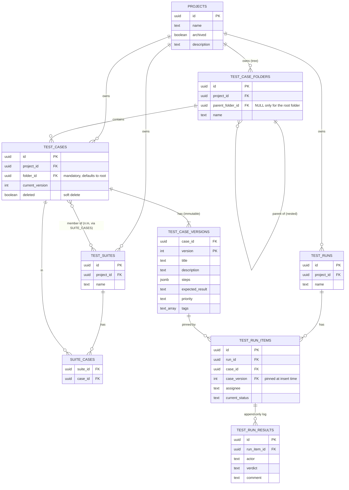

# Database

PostgreSQL 16+. Schema managed by [goose](https://github.com/pressly/goose)
migrations embedded in the binary at
[`apps/api/internal/db/migrations/`](../apps/api/internal/db/migrations/) —
**those SQL files are the source of truth**; this page is the readable
narrative on top of them, kept in sync with every schema-changing PR.
Migrations apply automatically and idempotently at API startup (see
[Deployment](deployment.md)).

## Entity relationships



Two independent groupings sit on top of `test_cases`, deliberately orthogonal: **folders** (`test_case_folders`, one case → exactly one folder, a browsing/organization tree) and **suites** (`suite_cases`, n:m, an execution grouping). Moving a case between folders never touches its suite memberships, and vice versa.

## Tables

### `projects`
The top-level container for all test assets. `archived` is a soft flag, not a delete. A `projects_create_root_folder` trigger fires on every insert, creating that project's root folder in the same transaction — the root's existence is a database guarantee, not an application convention. `description` is free text, defaulting to `''`. There is no owner column: `enrich-project-list` originally added one, but `add-project-rbac` removed it (amended in place, pre-1.0 policy) — a project's access is now entirely determined by `project_members`/`project_team_roles`, not a single nominal owner.

### `project_favorites`
Per-user starred projects (`enrich-project-list`), added alongside the identity tables in `00003_identity.sql` since both its FKs reference `users`. Composite PK `(user_id, project_id)`; both FKs `ON DELETE CASCADE` — a favorite has no meaning once either side is gone, unlike audit or result history, which must survive deletion.

### `test_case_folders`
A self-referencing tree per project for **organizing** cases (independent of suites, which are for **executing** them). Exactly one row per project has `parent_folder_id IS NULL` — the auto-created root — enforced by a partial unique index (`test_case_folders_one_root_idx`). Every other folder requires an explicit parent; the API never allows creating a second root. Deleting a non-root folder reparents its direct child folders and cases to its own parent (never orphans, never cascades destructively); the root folder cannot be deleted.

### `test_cases` + `test_case_versions`
**Every edit to a test case creates a new immutable version row; nothing in `test_case_versions` is ever updated or deleted.**

- `test_cases` holds identity and two pointers: `current_version` (the version editors see and new runs pin to) and `folder_id` (mandatory FK to `test_case_folders`, defaulting to the project's root when not specified) — plus `deleted` (soft delete — case disappears from authoring lists, but its versions remain joinable).
- `test_case_versions` holds the actual content per version: `title`, `description`, `steps` (JSONB array of `{action, expected}`), `expected_result`, `priority`, `tags`. Primary key `(case_id, version)`.

This split exists so a run can reference `(case_id, version)` directly (via FK) and get immutable content forever, regardless of later edits — see [architecture.md](architecture.md) and the `add-core-domain` design doc for the reasoning.

### `test_suites` + `suite_cases`
`test_suites` is a named grouping per project. `suite_cases` is the n:m join table (`suite_id`, `case_id`); removing a row here never touches `test_cases`.

### `test_runs`
A named execution container per project.

### `test_run_items`
One row per case included in a run, **pinned to an exact `(case_id, case_version)` at insert time** — either when the run is created or when a case is later added to an open run. The pin never changes even if the case is edited afterward or soft-deleted; the API surfaces a `newerVersion` flag by comparing against the case's current version. `current_status` is one of `pending / pass / failed / skipped / blocked / retest` and is the fast-read cache of "what does the log currently imply" — it's written in the same transaction as a new result, or directly via the status endpoint (assign, retest). Unique on `(run_id, case_id)`: a case appears at most once per run.

### `test_run_results`
**Append-only** — application code only ever inserts here, never updates or deletes. Each row is one verdict event: `actor` (free text until `add-identity-basics` gives it real identity), `verdict` (`pass/failed/skipped/blocked` — never `pending`/`retest`, those are statuses, not verdicts), optional `comment`, `created_at`. This is the audit trail and, later, the raw data for flaky-test detection (v0.3 reporting).

### `users`, `teams`, `team_members`, `roles`, `project_members`, `project_team_roles`
Identity and access (`add-identity-basics`, extended by `add-project-rbac`) — kept out of the ER diagram above since it's a separate concern from the core test-asset domain. `users.is_tenant_admin` is the one instance-wide flag; everything else is project-scoped. `teams`/`team_members` are a plain named-group-of-users pair with no scope of their own.

`roles` holds fully custom, instance-wide roles (design.md D10 — this replaced an earlier fixed `project_role` enum): `id, name (unique), rank (display order only), can_read, can_case_create, can_case_edit, can_case_delete, can_section_create, can_section_delete, can_suite_create, can_suite_edit_membership, can_run_create, can_run_record_result, can_manage_project, created_at` — ten concrete, per-resource flags (design.md D11 revised an earlier set of five broader ones, e.g. a single `can_author` that bundled case/section/suite authoring together). The Tenant Admin creates/renames/deletes rows here freely via `/api/v1/roles`. A fresh instance is seeded with three rows — Tester (`can_read, can_run_create, can_run_record_result`), Contributor (Tester's flags plus `can_case_create, can_case_edit, can_section_create, can_suite_create, can_suite_edit_membership`), Project Admin (Contributor's flags plus `can_case_delete, can_section_delete, can_manage_project`) — reproducing the old fixed model's net behavior by default.

`project_members` (`project_id, user_id, role_id`) and `project_team_roles` (`project_id, team_id, role_id`) are where access actually lives, `role_id` referencing `roles(id) ON DELETE CASCADE` — deleting a role removes every assignment that referenced it. A user's **effective permissions** on a project are the union (`bool_or` per flag) of every role reachable via either table (direct membership, or membership in a team that's itself assigned a role) — not a single "highest" role, since roles carry no fixed ranking once they're fully custom. No row in either table means no access at all, not even read. All FKs `ON DELETE CASCADE` — membership has no meaning once the user, team, role, or project it references is gone.

## Constraints worth knowing

- `test_run_items.current_status` and `test_run_results.verdict` are both `CHECK`-constrained at the database level, not just validated in Go — the domain package (`internal/domain`) and the schema agree on the same enum.
- `test_run_items` has a composite FK to `test_case_versions(case_id, version)`, which is what makes "run items always point at real, immutable content" a database guarantee rather than an application convention.

## Local access

```bash
docker compose -f deploy/compose/docker-compose.yml exec db \
  psql -U testpulse -d testpulse
```
