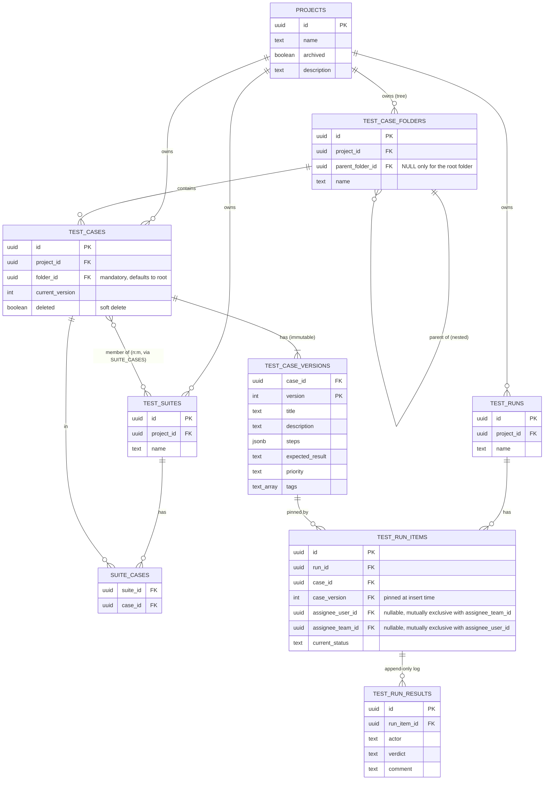

# Database

PostgreSQL 16+. Schema managed by [goose](https://github.com/pressly/goose)
migrations embedded in the binary at
[`apps/api/internal/db/migrations/`](../apps/api/internal/db/migrations/) —
**those SQL files are the source of truth**; this page is the readable
narrative on top of them, kept in sync with every schema-changing PR.
Migrations apply automatically and idempotently at API startup (see
[Deployment](deployment.md)).

## Entity relationships



Two independent groupings sit on top of `test_cases`, deliberately orthogonal: **folders** (`test_case_folders`, one case → exactly one folder, a browsing/organization tree) and **suites** (`suite_cases`, n:m, an execution grouping). Moving a case between folders never touches its suite memberships, and vice versa.

## Tables

### `projects`
The top-level container for all test assets. `archived` is a soft flag, not a delete. A `projects_create_root_folder` trigger fires on every insert, creating that project's root folder in the same transaction — the root's existence is a database guarantee, not an application convention. `description` is free text, defaulting to `''`. There is no owner column: `enrich-project-list` originally added one, but `add-project-rbac` removed it (amended in place, pre-1.0 policy) — a project's access is now entirely determined by `project_members`/`project_team_roles`, not a single nominal owner. `is_sample` (`add-sample-project`) is `true` for exactly one project — the automatically-seeded showroom project a fresh instance gets on first startup — and `false` for every normally-created project.

### `project_favorites`
Per-user starred projects (`enrich-project-list`), added alongside the identity tables in `00003_identity.sql` since both its FKs reference `users`. Composite PK `(user_id, project_id)`; both FKs `ON DELETE CASCADE` — a favorite has no meaning once either side is gone, unlike audit or result history, which must survive deletion.

### `test_case_folders`
A self-referencing tree per project for **organizing** cases (independent of suites, which are for **executing** them). Exactly one row per project has `parent_folder_id IS NULL` — the auto-created root — enforced by a partial unique index (`test_case_folders_one_root_idx`). Every other folder requires an explicit parent; the API never allows creating a second root. `deleted boolean NOT NULL DEFAULT false` (`add-delete-mode`) mirrors `test_cases.deleted` — `test_case_folders_project_idx`/`test_case_folders_parent_idx` are `WHERE NOT deleted` filtered indexes. Deleting a non-root folder soft-deletes it and every folder and case anywhere in its subtree in one transaction (a `WITH RECURSIVE` walk of `parent_folder_id`), replacing the previous reparent-on-delete behavior; the root folder cannot be deleted.

### `test_cases` + `test_case_versions`
**Every edit to a test case creates a new immutable version row; nothing in `test_case_versions` is ever updated or deleted.**

- `test_cases` holds identity and two pointers: `current_version` (the version editors see and new runs pin to) and `folder_id` (mandatory FK to `test_case_folders`, defaulting to the project's root when not specified) — plus `deleted` (soft delete — case disappears from authoring lists, but its versions remain joinable).
- `test_case_versions` holds the actual content per version: `title`, `description`, `steps` (JSONB array of `{action, expected}`), `expected_result`, `priority`, `tags`. Primary key `(case_id, version)`. `actor_kind` (`user`/`agent`/`unknown`) and `actor_ref_id` (`link-case-version-actor-to-identity`) denormalize the authenticated actor who created the version, the same pattern `test_run_results` already uses — no FK on `actor_ref_id`, so attribution survives that actor being deleted, and versions created before this capability shipped read back as `unknown` rather than a fabricated identity.

This split exists so a run can reference `(case_id, version)` directly (via FK) and get immutable content forever, regardless of later edits — see [architecture.md](architecture.md) and the `add-core-domain` design doc for the reasoning.

### `test_suites` + `suite_cases`
`test_suites` is a named grouping per project. `suite_cases` is the n:m join table (`suite_id`, `case_id`); removing a row here never touches `test_cases`.

### `test_runs`
A named execution container per project. `status` (`add-run-lifecycle-status`) is `open` or `closed` — a closed run's items become read-only (no new results, status/assignee updates, or added items) until an actor with `manageProject` reopens it.

### `test_run_items`
One row per case included in a run, **pinned to an exact `(case_id, case_version)` at insert time** — either when the run is created or when a case is later added to an open run. The pin never changes even if the case is edited afterward or soft-deleted; the API surfaces a `newerVersion` flag by comparing against the case's current version. `current_status` is one of `pending / pass / failed / skipped / blocked / retest` and is the fast-read cache of "what does the log currently imply" — it's written in the same transaction as a new result, or directly via the status endpoint (assign, retest). Unique on `(run_id, case_id)`: a case appears at most once per run. `test_name` (`add-execution-import`) is the literal name an external runner reported for this item, empty for items added manually. `assignee_user_id`/`assignee_team_id` (`link-run-item-assignee-to-identity`) are nullable FKs to `users`/`teams`, `CHECK`-constrained to be mutually exclusive, both `ON DELETE SET NULL` — an item's assignment is a real reference, not free text, and reverts to unassigned rather than surviving as a dangling name if the assigned user or team is later deleted. This was a breaking migration (the earlier free-text `assignee` column was dropped, not preserved alongside), acceptable pre-1.0 since no version had shipped yet.

### `test_run_results`
**Append-only** — application code only ever inserts here, never updates or deletes. Each row is one verdict event: `actor` (a display name — the authenticated caller's by default, or an explicit override), `verdict` (`pass/failed/skipped/blocked` — never `pending`/`retest`, those are statuses, not verdicts), optional `comment`, `created_at`. This is the audit trail and, later, the raw data for flaky-test detection (v0.3 reporting). `start_time`/`end_time`, `platform`, `version`, and `tags` (`add-execution-import`) are optional execution metadata, populated by an import or a manually-recorded result alike. `actor_kind` (`user`/`agent`/`unknown`) and `actor_ref_id` (`link-result-actor-to-identity`) denormalize the real authenticated actor behind the result, the same way `audit_log.actor_name`/`actor_id` do — `actor_ref_id` carries no FK so a result's attribution survives that actor being deleted later; rows recorded before this capability shipped read back as `unknown` rather than a fabricated identity. Even when `actor` is overridden by the client, `actor_kind`/`actor_ref_id` still reflect who was actually authenticated — an override changes what's displayed, never who is cryptographically known to have made the request.

### `result_attachments`
Image evidence (screenshots) attached to a run item result (`add-run-item-screenshot-attachments`). `id` (PK), `run_item_id` (FK → `test_run_items(id)` `ON DELETE CASCADE`), `result_id` (nullable FK → `test_run_results(id)` `ON DELETE CASCADE`), `filename`, `content_type`, `image bytea`, `created_at`. `run_item_id` is set on every row even before `result_id` is known — a screenshot pasted while a verdict is still being composed is "staged" (`result_id IS NULL`) and scoped to its item until `recordResult`'s `attachmentIds` links it, or an actor discards the page without recording anything, leaving it permanently unlinked (a known, accepted gap — see the change's design.md; cleanup of these is left to `add-data-retention`). Unlike `user_avatars`, images are stored exactly as uploaded — no crop, resize, or re-encode, since evidence must not be silently altered. Bytes live in Postgres, not object storage, the same `bytea`-in-a-separate-table shape `user_avatars` established, so listing a result's history never pulls image bytes along with it.

### `users`, `teams`, `team_members`, `roles`, `project_members`, `project_team_roles`
Identity and access (`add-identity-basics`, extended by `add-project-rbac`) — kept out of the ER diagram above since it's a separate concern from the core test-asset domain. `users.is_tenant_admin` is the one instance-wide flag; everything else is project-scoped. `teams`/`team_members` are a plain named-group-of-users pair with no scope of their own. `users.display_name`, `avatar_key`, `timezone` (`add-user-profile`, all nullable) are self-service profile fields a user sets on their own row via `PATCH /api/v1/users/me`. `avatar_key` is either a plain string key into a fixed, bundled set of preset portraits (`domain.AvatarPresetKeys`; static files, not a table), the reserved value `"custom"` meaning the user has uploaded their own photo (see `user_avatars` below), or unset — rendering as a generated initial-on-color chip. Teams have no equivalent avatar concept — they keep their existing generated-color chip unchanged.

### `user_avatars`
One row per user with a custom uploaded photo avatar (`add-custom-avatar-upload`) — a separate table, not columns on `users`, so the common case of listing/fetching users never pulls image bytes along with it. `user_id` (PK, FK → `users(id)` `ON DELETE CASCADE`), `image bytea`, `content_type` (always `image/jpeg` — every upload is re-encoded regardless of its original format, both to strip embedded metadata and to keep serving simple), `updated_at` (used to derive the `ETag`/`Cache-Control` the serving endpoint sends). Populated only via `POST /api/v1/users/me/avatar` (server-side validated, center-cropped, and resized to 128×128 before storage — see `avatarimage.ProcessAvatarUpload`); a row is deleted, and the owning user's `avatar_key` cleared back to unset, via `DELETE /api/v1/users/me/avatar`.

`roles` holds fully custom, instance-wide roles (design.md D10 — this replaced an earlier fixed `project_role` enum): `id, name (unique), rank (display order only), can_read, can_case_create, can_case_edit, can_case_delete, can_section_create, can_section_delete, can_suite_create, can_suite_edit_membership, can_run_create, can_run_record_result, can_manage_project, created_at` — ten concrete, per-resource flags (design.md D11 revised an earlier set of five broader ones, e.g. a single `can_author` that bundled case/section/suite authoring together). The Tenant Admin creates/renames/deletes rows here freely via `/api/v1/roles`. A fresh instance is seeded with three rows — Tester (`can_read, can_run_create, can_run_record_result`), Contributor (Tester's flags plus `can_case_create, can_case_edit, can_section_create, can_suite_create, can_suite_edit_membership`), Project Admin (Contributor's flags plus `can_case_delete, can_section_delete, can_manage_project`) — reproducing the old fixed model's net behavior by default.

`project_members` (`project_id, user_id, role_id`) and `project_team_roles` (`project_id, team_id, role_id`) are where access actually lives, `role_id` referencing `roles(id) ON DELETE CASCADE` — deleting a role removes every assignment that referenced it. A user's **effective permissions** on a project are the union (`bool_or` per flag) of every role reachable via either table (direct membership, or membership in a team that's itself assigned a role) — not a single "highest" role, since roles carry no fixed ranking once they're fully custom. No row in either table means no access at all, not even read. All FKs `ON DELETE CASCADE` — membership has no meaning once the user, team, role, or project it references is gone.

## Constraints worth knowing

- `test_run_items.current_status` and `test_run_results.verdict` are both `CHECK`-constrained at the database level, not just validated in Go — the domain package (`internal/domain`) and the schema agree on the same enum.
- `test_run_items` has a composite FK to `test_case_versions(case_id, version)`, which is what makes "run items always point at real, immutable content" a database guarantee rather than an application convention.

## Local access

```bash
docker compose -f deploy/compose/docker-compose.yml exec db \
  psql -U testpulse -d testpulse
```
